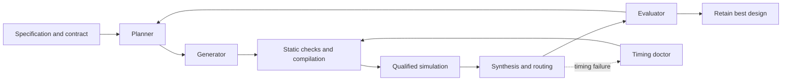

# AutoRTL

[](https://github.com/Baah134/autortl/actions/workflows/tests.yml)

**An agentic FPGA design loop where the model only proposes and verification decides.**

AutoRTL writes and optimizes Verilog with a team of LLM agent roles, driving
AMD Vivado from the command line. Every candidate must pass static checks,
simulation against a testbench that has itself been shown to catch injected
bugs, and place-and-route timing before it can replace the current design.
The agents read the specification but cannot change it, the testbench, the
TCL or the acceptance gates.

Everything below was produced by the harness's own roles and measured by
Vivado 2025.2 on the Basys 3's FPGA (`xc7a35tcpg236-1`), then run on a real
board. Every number links to an archived run.

## Highlights

- **Harness-built logic drives a real pin.** From a typed specification, the
  harness generated and optimized a UART transmitter (40 → 24 LUTs). That
  exact file drives the Basys 3's USB-UART pin and **streamed 1,000,000 of
  1,000,000 bytes at full line rate with 0 errors**
  ([evidence](evidence/2026-10-29/harness-uart-tx-v2-01/README.md)).
- **Six optimized designs, all verified on hardware.** A signed FIR filter,
  two dot products, a divider and two FIFOs. Each ran unedited on the board
  and passed 50,000 transactions against an independent model under
  randomized backpressure, with 0 mismatches.
- **Real optimization, not just passing tests.** The FIR went from failing
  timing at 78 LUTs to 52 LUTs with positive slack, and a dot product from
  328 to 20 LUTs by moving arithmetic into DSP slices.
- **Verifiers that are tested themselves.** Before a testbench may grade
  anything, it must pass a correct design and fail deliberately broken ones.
  An audit injected 27 faults into the FIR: generated testbenches first caught
  18, improved stimulus raised that to 22, and the independent checker caught
  all 27.
- **Reproducible by construction.** 1,516 regression tests, crash-safe
  resumable runs, fixed model-call and tool-time budgets, and a CI audit that
  checks over 34,000 recorded SHA-256 claims against the committed bytes.
  Curriculum tier 0 is held: three consecutive fresh runs on the same frozen
  harness passed every gate
  ([campaign 17](evidence/2026-10-29/contract-campaign-17/README.md)).

## How it works



### Agent roles

Each role gets an isolated view of the run and one job. None of them can
change the specification, the testbench or the gates.

| Role | Sees | Produces |
|---|---|---|
| **Planner** | The request, immutable run facts, progress and verified metrics | A typed design spec from a prose request; a plan and hypothesis for each iteration. It never writes Verilog. |
| **Generator** | The plan, the fixed contract and the current source | Verilog candidates, the Python golden model, and repairs from compiler and simulator diagnostics |
| **Evaluator** | The candidate, its verified metrics and the deterministic results | ACCEPT or REJECT on what the tools cannot judge. It can veto, but never overrule a failed gate. |
| **Timing doctor** | A diagnosed critical path from the routed timing report | Targeted RTL surgery, measured as a separate trial and adopted only if it verifies |

Deterministic code does everything else: spec lint, testbench generation,
mutation qualification of testbenches, compilation, simulation, synthesis,
routing, metric extraction and selection. Model output is stored only as
Verilog, Python or JSON specification files, and is never interpolated into
TCL, shell commands or paths.

### Guarantees

- **Fixed contracts.** Interfaces, reset behavior and cycle latency come from
  a typed specification. A candidate that changes them fails; it is never
  renegotiated.
- **Measured selection.** Timing feasibility comes before resource savings.
  Candidates are deduplicated by exact source, and every score comes from
  routed Vivado reports.
- **Safe failure handling.** Tool crashes, locks and timeouts never alter the
  design or count as a failed attempt. Message severities can be raised,
  never lowered.
- **Traceable evidence.** Every result is archived with source hashes,
  constraints, tool version and raw reports
  ([audit](evidence/2026-10-28/evidence-integrity-01/README.md)).

## What the agent actually changed

In the FIR run, the baseline core passed the backpressure signal through a
three-stage combinational chain and multiplied by constants:

```verilog
wire ready3 = !valid3 || out_ready;
wire ready2 = !valid2 || ready3;
wire ready1 = !valid1 || ready2;
assign in_ready = ready1;
...
(x_wide * 16'sd3) - (history1_wide * 16'sd5) + (history2_wide * 16'sd7) - (history3_wide * 16'sd2)
```

The verified winner tracks pipeline occupancy in a register instead, which
cuts the input-ready path to a single gate, and it uses shift-and-add terms:

```verilog
assign in_ready = !full || out_ready;
...
full <= next_valid1 && next_valid2 && next_valid3;   // inside the clocked block
...
wire signed [15:0] x_times3        = (x_wide <<< 1) + x_wide;
wire signed [15:0] history1_times5 = (history1_wide <<< 2) + history1_wide;
wire signed [15:0] history2_times7 = (history2_wide <<< 3) - history2_wide;
```

Full sources: [baseline core](evidence/2026-10-26/generated-signed-fir4-attempt-01/run/modules/signed_fir4_core/signed_fir4_core.v)
and [winner](evidence/2026-10-26/generated-signed-fir4-attempt-01/run/signed_fir4_best.v).

## Verified results

| Design | Result | Verification |
|---|---|---|
| Signed stateful FIR filter | 78 → 52 LUTs · setup −0.327 → +0.169 ns · hold +0.106 ns | Independent 800-cycle test |
| Elastic dot product | 328 → 20 LUTs · 4 DSPs · setup +0.155 ns · hold +0.206 ns | Independent 852-cycle test |
| Three-module pipelined dot product | 325 → 17 LUTs · 4 DSPs | Independent 685-cycle test |
| Iterative divider (8-bit) | 38 → 26 LUTs · setup +0.315 ns · hold +0.129 ns | Independent test of the saved winner |
| FIFO timing recovery | Setup −0.931 → +0.108 ns · hold +0.076 ns · 22 LUTs / 13 FFs | 50,000 transactions on the board |
| Packet-tagged FIFO | 23 LUTs / 31 FFs · setup +0.078 ns · hold +0.106 ns | Independent test of the saved winner |
| UART transmitter (harness-built) | 40 → 24 LUTs | 1,000,000-byte line-rate stream on the board |
| Fault-qualified verification | 27 FIR, 18 elastic dot-product and 20 divider faults detected | Correct controls passed |
| Curriculum tier 0 (counter, mux4) | Held: 3 consecutive qualifying runs · counter 55 → 31 LUTs | All mandatory gates |

All at 100 MHz with ideal zero I/O delays. The dot-product savings trade fabric logic for DSP slices, and FIFO
timing recovery uses more area than its failing baseline. Estimated power
rose slightly for the dot products and the divider. A second FIR run with the
same specification reached timing at 84 LUTs, so results vary between runs
and single runs are reported as single runs. Details:
[hardware targets](docs/TARGETS.md).

**Fmax.** Out of context, the six winners close at 181.8 MHz (FIR) to
425.5 MHz (packet FIFO). In the harness's own flow every critical path ends at
an I/O buffer, so the harness's timing objective mostly measures pad delay
([Fmax study](hardware/basys3/fmax/README.md)).

Evidence: [signed FIR](evidence/2026-10-26/generated-signed-fir4-attempt-01/README.md),
[FIR fault qualification](evidence/2026-10-25/signed-fir4-admission-attempt-01/README.md),
[second FIR run](evidence/2026-10-26/generated-signed-fir4-attempt-02/README.md),
[generated-verifier audit](evidence/2026-10-26/fir4-driver-comparison-01/README.md),
[elastic dot product](evidence/2026-10-25/generated-elastic-dot4-attempt-02/README.md),
[three-module dot product](evidence/2026-10-24/generated-dot4-attempt-01/README.md),
[divider](evidence/2026-10-23/generated-divider-attempt-01/README.md),
[FIFO](evidence/2026-10-22/generated-fifo-attempt-05/README.md),
[packet FIFO](evidence/2026-10-22/generated-packet-attempt-01/README.md),
[Fmax](evidence/2026-10-29/fmax-characterization-01/README.md).

## Hardware validation on a Basys 3

[`hardware/basys3/harness_winners`](hardware/basys3/harness_winners/README.md)
runs every harness winner on the board through one generic, tested shell:

| Design | On board vs model | Winner LUT / FF / DSP on board | Harness-measured |
|---|---|---:|---:|
| Signed FIR | 50,000/50,000 | 51 / 67 / 0 | 52 / 67 / 0 |
| Elastic dot product | 50,000/50,000 | 20 / 20 / 4 | 20 / 20 / 4 |
| Pipelined dot product | 50,000/50,000 | 17 / 18 / 4 | 17 / 18 / 4 |
| Iterative divider | 50,000/50,000 | 26 / 30 / 0 | 26 / 38 / 0 |
| Packet FIFO | 50,000/50,000 | 22 / 29 / 0 | 23 / 31 / 0 |
| Sync FIFO | 50,000/50,000 | 21 / 13 / 0 | 22 / 13 / 0 |

- **Independent models.** Each design is checked against a Python model
  written from the frozen specification, not from the harness's own oracle.
- **Real backpressure.** An LFSR traffic shaper creates the valid/ready stress
  that UART traffic alone never would. Coverage counters prove it happened,
  and each design's injected fault must make its simulation fail.
- **Explained differences.** The divider's 8-FF difference turned out to be
  `opt_design` replicas that exist only when it is built standalone
  ([analysis](evidence/2026-10-28/divider-ff-replica-analysis-01/README.md)).
- **Replayable.** The tested bitstreams are archived and tied by hash to the
  hardware runs, so a board and a fresh clone can rerun every check without
  synthesis. A replay reproduced all six results exactly
  ([replay](evidence/2026-10-28/basys3-bitstream-replay-01/README.md)).

### Harness-built UART transmitter

The harness generated a UART transmitter from a typed specification written
for the board (34 → 22 LUTs, 14 model calls, 9.4 minutes). The unedited file
drives the board's TX pin and echoed 100,000 of 100,000 bytes, while a
wrong-baud control failed as required. No human-written RTL is in the
transmit path ([design](hardware/basys3/harness_built/uart_tx/README.md),
[evidence](evidence/2026-10-29/harness-uart-tx-01/README.md)).

The board then exposed a flaw in the contract, not the RTL. A continuous
stream lost a byte at 19,392 for two different generated designs, because the
spec required a full-length stop bit while the PC sends about 0.17% fast. The
specification was changed to a stop bit shortened by 1/16, the harness
regenerated the transmitter, and the new one streamed 1,000,000 bytes with 0
errors ([evidence](evidence/2026-10-29/harness-uart-tx-v2-01/README.md)).

<details>
<summary>Board bring-up history</summary>

- **UART echo.** The board path was proven first with a hand-written echo
  ([`uart_echo`](hardware/basys3/uart_echo/README.md)). It passed chunked tests;
  an independent review predicted it would drop bytes under continuous
  traffic, and a line-rate test confirmed a loss after 9,696 bytes. The fix
  shortens the stop bit by 1/16, each fix has a simulation that fails when it
  is reverted, and the fixed design streamed 1,000,000 bytes with zero loss
  ([evidence](evidence/2026-10-28/basys3-uart-echo-02/README.md)).
- **FIR alone.** [`fir4_on_board`](hardware/basys3/fir4_on_board/README.md)
  ran the FIR winner, byte-identical to the verified file, behind a
  hand-written UART shell: 100,000 samples matched across 4 restarts, a model
  with one wrong coefficient failed on 4,965 of 5,000 outputs, and the build
  had 0 warnings with +2.718 ns setup slack
  ([evidence](evidence/2026-10-28/basys3-fir4-01/README.md)).

</details>

## What went wrong, and what changed

- **The generated verifiers missed bugs.** Generated testbenches passed 9 of
  27 injected faults. Signed boundary values, legal idle traffic and
  off-edge reset pulses raised detection to 22/27 without changing the oracle
  or budgets. The remaining 5 involve reset behavior the generic specification
  cannot express, so independent contract checks still cover them.
- **A generated winner fooled a testbench.** The UART winner inlined its child
  module, and the stale child file kept a testbench that names it passing. The
  harness now rejects candidates that stop instantiating a component the
  trusted testbench uses, and a rerun kept the child and passed the same board
  checks ([evidence](evidence/2026-10-29/harness-uart-tx-02/README.md)).
- **A passing test is not proof.** The UART's first test paused between
  chunks and could never fail the way the design actually failed. Every new
  check now ships with a fault that it must catch.
- **The archives had holes.** A repository-wide audit found 837 of 27,073
  recorded claims that the committed files did not back up, mostly simulator
  files a manifest listed but that were never copied. The bytes were restored
  where they survived; the rest are proven another way or recorded as losses,
  each pinned to its digest. CI now fails if any claim stops matching
  ([audit](evidence/2026-10-28/evidence-integrity-01/README.md)).

Every new failure mode gets an entry in the error taxonomy
([`data/taxonomy.yaml`](data/taxonomy.yaml)) before its fix lands.

## Limits

These are bounded experiments on small designs. They are not formal
equivalence proofs or board-level timing sign-off, and they do not show that
the harness beats a skilled engineer or Vivado's own optimizations. Only
tier 0 (two small designs) of the curriculum is held. Model calls go through
the Codex CLI.

## Quick start

Requirements: Python 3.12, Vivado with the target device installed, and an
authenticated Codex CLI for model-driven runs. Roles are routed through
[`llm/routing.yaml`](llm/routing.yaml).

```powershell
python -m pip install -r requirements.txt
```

To see one run's pipeline without Vivado or a model login, run the simulated
walkthrough. It optimizes `mux4` once with fixed stand-ins, measures nothing,
and prints where the run's journal, events and summary are:

```powershell
python scripts/demo.py
```

Set the Vivado installation path. The following examples use PowerShell:

```powershell
$vivadoBin = "C:/path/to/Vivado/bin"
$vivadoArgs = @(
  "--vivado", "$vivadoBin/vivado.bat",
  "--xvlog", "$vivadoBin/xvlog.bat",
  "--xelab", "$vivadoBin/xelab.bat",
  "--xsim", "$vivadoBin/xsim.bat"
)
```

Check the machine first. `doctor` finds Python and its packages, the four
Vivado tools and the Codex CLI login, and prints the exact fix for anything
missing. It runs no design and sends nothing to a model:

```powershell
python run.py doctor @vivadoArgs
```

Then run the repeatable counter tool check without model calls:

```powershell
python scripts/check_counter_cli.py --bin-dir $vivadoBin --output runs/counter-check
```

Optimize an existing design with a testbench and bounded resources:

```powershell
python run.py optimize --design curriculum/tier0/mux4/mux4.v `
  --tb curriculum/tier0/mux4/mux4_tb.v --top mux4 `
  --iterations 1 --best-of-n 1 --max-llm-calls 16 `
  --max-vivado-minutes 20 --max-wall-minutes 30 `
  --output-dir runs/mux-trial @vivadoArgs
```

`build` accepts a typed JSON specification or a prose request. The repository
includes [signed FIR](curriculum/tier3/signed_fir4_build/),
[counter8](curriculum/tier1/counter8_build/) and
[priority encoder](curriculum/tier1/encoder8_build/) specifications with
independent top-level testbenches. Supply these using `--spec`, `--tb` and `--top`.
Add `--generate-golden` to combine generated Python/unit verification with the
independent testbench. See the
[golden verification guide](docs/GOLDEN_VERIFICATION.md) for semantics and limits.

Choose the model with `--model` (any model alias the Codex CLI accepts, for
example `gpt-6-luna` or `gpt-5.6-luna`). Every role uses it, it is saved in the
run's `config.json`, and the curriculum records it as the requested model
identity, so runs on different models never share a cohort. Without `--model`
the CLI's own default is used and the model identity is recorded as unobserved.
The role parsers accept the fence tags and verdict layouts different models
write (`Verilog`, `v`, `py`, `Recommendation: ACCEPT`), and a planner-written
spec that fails the structural check gets its errors back for a bounded repair.

To run the roles on any OpenAI-compatible chat-completions API instead of the
Codex CLI, set `AUTORTL_OPENAI_API_KEY` in the environment and pass
`--model openai.<model>` (for example `--model openai.gpt-4o-mini`). The
endpoint defaults to `https://api.openai.com/v1`; set
`AUTORTL_OPENAI_BASE_URL` to use another provider or a local server such as
Ollama (`http://localhost:11434/v1`) or vLLM (`http://localhost:8000/v1`).
Local servers that ignore the key still need a placeholder value. The key is
read only from the environment and is never written to run files or logs.
`python run.py doctor` reports whether the key is set.

Resume an interrupted experiment using its saved configuration:

```powershell
python run.py resume --run runs/mux-trial
```

Use a fresh output directory for each new experiment. Resume checks the saved
inputs and execution environment; see [recovery behavior](docs/RECOVERY.md).

The same steps in bash (Linux or Git Bash). On Linux the tools have no
`.bat` suffix; in Git Bash, add it as in the PowerShell example:

```bash
vivado_bin=/path/to/Vivado/bin
vivado_args=(--vivado "$vivado_bin/vivado" --xvlog "$vivado_bin/xvlog"
             --xelab "$vivado_bin/xelab" --xsim "$vivado_bin/xsim")

python run.py doctor "${vivado_args[@]}"

python scripts/check_counter_cli.py --bin-dir "$vivado_bin" --output runs/counter-check

python run.py optimize --design curriculum/tier0/mux4/mux4.v \
  --tb curriculum/tier0/mux4/mux4_tb.v --top mux4 \
  --iterations 1 --best-of-n 1 --max-llm-calls 16 \
  --max-vivado-minutes 20 --max-wall-minutes 30 \
  --output-dir runs/mux-trial "${vivado_args[@]}"
```

## Repository map

| Path | Contents |
|---|---|
| [`autortl/`](autortl/) | The harness: orchestrator (`fsm.py`), roles, prompts, verification ladder, Vivado driver |
| [`llm/`](llm/) | Model client, backend adapter and role routing |
| [`curriculum/`](curriculum/) | Tiered benchmark designs and the promotion rules |
| [`data/taxonomy.yaml`](data/taxonomy.yaml) | Vivado message IDs and recorded harness failure modes |
| [`hardware/basys3/`](hardware/basys3/) | Board shells, constraints, bitstream builds and PC-side checkers |
| [`evidence/`](evidence/) | Archived runs, each with a README and a hash manifest |
| [`tests/`](tests/) | Harness regression suite |
| [`docs/`](docs/) | Architecture, code tour, recovery guide and progress log |

## Development and evaluation

Continuous integration
([`.github/workflows/tests.yml`](.github/workflows/tests.yml)) runs the full
harness suite on Windows, the mailbox and board-suite tests on Windows and
Ubuntu, and the evidence audit. None of these need Vivado, a model login or a
board.

```powershell
python -m pytest tests/ -q
python -m pytest coordination hardware/basys3/harness_winners/tests -q
python tools/evidence_audit.py --rev HEAD
python run.py bench --tier 0 --iterations 1 --best-of-n 1 `
  --max-llm-calls 16 --max-vivado-minutes 20 --max-wall-minutes 30 `
  --output-dir runs/tier0 @vivadoArgs
```

Add `--jobs 4` to run up to four entries at once as separate processes; the
cohort and promotion rules do not change. Each run's `budget.json` records the
model tokens it used, and `python tools/role_report.py <campaign>` summarizes
every role's calls, tokens, verdicts and repairs.

Curriculum promotion requires three consecutive qualifying full runs with the
same experiment cohort. Subset runs cannot promote a tier, and regressions in
previously passing entries of a held cohort block qualification.

Start with the [guided code tour](docs/WALKTHROUGH.md), which follows one run
through the code with file and line references. Then read the
[architecture](docs/DESIGN.md), [recovery and validation guide](docs/RECOVERY.md),
[research and adoption decisions](docs/RESEARCH.md),
and [engineering evidence log](docs/PROGRESS.md).

## Author

Prince Baah-Mensah. AutoRTL is a personal FPGA and verification project.
