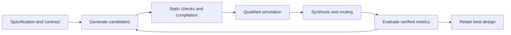

# AutoRTL

**An AI-assisted RTL design and optimization harness with verification at every stage.**

AutoRTL turns hardware specifications into Verilog and iteratively improves
existing designs using AMD Vivado. Planner, generator, evaluator and timing
specialist roles propose changes; simulation, implementation reports and
deterministic acceptance gates decide which results survive.

The goal is a repeatable autonomous engineering loop: generate, verify, measure,
learn from failures, and retain the best correct design within a fixed budget.

## Verified progress

| Validation | Recorded result |
|---|---|
| Harness regression suite | **497 tests passed** |
| Live Vivado testbench checks | **20 generated-testbench, counter and FIFO reference/mutation cases matched expected verdicts** |
| Supervised mux simulation and routing | **8 LUTs · 8 FFs · setup slack 0.579 ns · hold slack 0.052 ns** |

Mux measurements use Vivado 2025.2, `xc7a35tcpg236-1` and a 10 ns clock,
with explicit ideal zero minimum/maximum I/O delays. These are experiment
constraints, not board timing requirements.

These results demonstrate supervised harness validation. Model-worker recovery has been exercised; accepted autonomous optimization
and full process-interruption campaigns remain under validation. No
optimization percentage or held curriculum tier is claimed.
The first bounded optimization cohort finished **0/2**, with failures preserved
and followed by targeted repairs.

See the [test evidence](evidence/2026-10-19/README.md),
[full-suite result](evidence/2026-10-20/fixed-contract-tests.txt) and
[live experiment reports](evidence/2026-10-19/live-tier0/README.md).

## The design loop



- **Fixed contracts:** optimization requirements come from immutable harness
  facts. Interfaces, reset behavior and cycle latency
  are checked against explicit module specifications.
- **Verification before scoring:** testbench qualification requires a passing
  control and detection of an injected fault. Missing or ambiguous evidence fails.
- **Measured candidate selection:** configurable best-of-N generation, source
  deduplication and deterministic scoring use verified tool results.
- **Recoverable execution:** atomic checkpoints, frozen inputs and stage journals
  support replay; source, configuration and report drift invalidate reuse.
- **Bounded experiments:** model-call, tool-time and wall-time budgets constrain
  work. Infrastructure failures receive bounded retries without RTL mutation.
- **Traceable results:** retained sources, constraints, hashes, reports and event
  records connect each result to its exact experiment.

## Quick start

Requirements: Python 3.12, Vivado with the target device installed, and an
authenticated Codex CLI for model-driven runs. Current runtime roles use the
configured Codex model through [`llm/routing.yaml`](llm/routing.yaml).

```powershell
python -m pip install -r requirements.txt
```

Set the Vivado installation path. The following examples use PowerShell:

```powershell
$vivadoBin = "C:/path/to/Vivado/bin"
$vivadoArgs = @(
  "--vivado", "$vivadoBin/vivado.bat",
  "--xvlog", "$vivadoBin/xvlog.bat",
  "--xelab", "$vivadoBin/xelab.bat",
  "--xsim", "$vivadoBin/xsim.bat"
)
```

First, run the repeatable counter tool check without model calls:

```powershell
python scripts/check_counter_cli.py --bin-dir $vivadoBin --output runs/counter-check
```

Optimize an existing design with a testbench and bounded resources:

```powershell
python run.py optimize --design curriculum/tier0/mux4/mux4.v `
  --tb curriculum/tier0/mux4/mux4_tb.v --top mux4 `
  --iterations 1 --best-of-n 1 --max-llm-calls 16 `
  --max-vivado-minutes 20 --max-wall-minutes 30 `
  --output-dir runs/mux-trial @vivadoArgs
```

`build` accepts a typed JSON specification or a prose request. The repository
includes [counter8](curriculum/tier1/counter8_build/) and
[priority encoder](curriculum/tier1/encoder8_build/) specifications with
independent top-level testbenches. Supply these using `--spec`, `--tb` and `--top`.

Resume an interrupted experiment using its saved configuration:

```powershell
python run.py resume --run runs/mux-trial
```

Use a fresh output directory for each new experiment. Resume checks the saved
inputs and execution environment; see [recovery behavior](docs/RECOVERY.md).

## Development and evaluation

```powershell
python -m pytest tests/ -q
python run.py bench --tier 0 --iterations 1 --best-of-n 1 `
  --max-llm-calls 16 --max-vivado-minutes 20 --max-wall-minutes 30 `
  --output-dir runs/tier0 @vivadoArgs
```

Curriculum promotion requires three consecutive qualifying full runs with the
same experiment cohort. Subset runs cannot promote a tier, and regressions in
previously passing entries of a held cohort block qualification.

Read the [architecture](docs/DESIGN.md), [recovery and validation guide](docs/RECOVERY.md)
and [engineering evidence log](docs/PROGRESS.md) for implementation details,
tested guarantees and remaining work.
