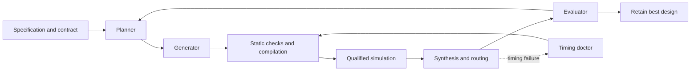

# AutoRTL

[](https://github.com/Baah134/autortl/actions/workflows/tests.yml)

**An agentic FPGA design loop where the model only proposes and verification decides.**

AutoRTL writes and optimizes Verilog with bounded LLM roles, driving AMD
Vivado from the command line. Before a candidate becomes the working best, it
must pass static checks, compilation and simulation with a fault-qualified
testbench. Routed reports govern selection: resource-saving wins require setup
and hold closure; an improvement toward closure can be retained explicitly as
timing progress.

The planner creates and repairs prose-derived specifications. RTL optimization
keeps the current contract, trusted testbench, TCL and acceptance gates fixed.

The generated cores below were measured with Vivado 2025.2 for the Basys 3's
FPGA (`xc7a35tcpg236-1`). Twelve were also checked on a real board through
hand-written shells and independent reference models. Archived runs distinguish
standalone implementation, simulation and hardware results.

## Results at a glance

| Claim | Evidence |
|---|---|
| **Generated cores run on real hardware.** Twelve optimized designs (RV32I CPU, AES-128, CORDIC, 16-tap FIR, SPI, CRC-16, FIFOs and more) each passed 50,000 transactions on a Basys 3 against an independent model with 0 mismatches. | [first six](evidence/2026-10-28/basys3-harness-winners-01/README.md), [CPU/CRC/SPI](evidence/2026-11-02/basys3-tier46-board-01/README.md), [AES/CORDIC/FIR16](evidence/2026-11-02/basys3-tier56-board-01/README.md) |
| **Agent-built UART echo.** Receiver and transmitter built by the roles echoed 1,000,000 of 1,000,000 bytes at full line rate. | [echo](evidence/2026-11-01/basys3-harness-echo-01/README.md) |
| **Real optimization.** AES-128: 9,108 to 614 LUTs, from missing timing by 9.8 ns to +2.2 ns. FIR16 closes 150 MHz (394 to 148 LUTs). Dot product: 328 to 20 LUTs through DSP inference. | [results in detail](docs/RESULTS.md) |
| **Verifiers are tested.** A testbench must pass a correct design and fail injected faults before it grades anything; an audit of 27 FIR faults went from 18 to 22 caught by generated testbenches, 27 by the independent checker. | [case study](docs/CASE_STUDY_VERIFIER.md) |
| **Registered comparison with a single model call.** 40 public VerilogEval tasks, three arms, three trials, tasks frozen before any run. In progress; the six-task pilot passed in all arms after exposing five harness defects, and an earlier pilot recorded one wrong design the harness accepted. No advantage is claimed yet. | [registration](evidence/2026-11-14/final-registration-01/README.md), [pilot](evidence/2026-11-14/pilot-06-results-01/README.md), [false acceptance](evidence/2026-11-14/pilot-04-results-01/README.md), [runbook](docs/BENCHMARK_PILOT.md) |
| **Reproducible.** About 2,300 harness tests and 320 tooling tests run in CI without Vivado, a model or a board; CI audits every evidence hash against committed bytes. | [tests](.github/workflows/tests.yml), [publication policy](docs/PUBLICATION.md) |

Measured with Vivado 2025.2 for the Basys 3 FPGA (`xc7a35tcpg236-1`). Board
checks use hand-written shells around unedited generated cores.

## How it works



### Agent roles

Each role receives the context for one job. The planner can create or repair
a prose-derived spec; optimization candidates cannot amend their current
contract or trusted verification inputs.

| Role | Sees | Produces |
|---|---|---|
| **Planner** | The request, immutable run facts, progress and verified metrics | A typed design spec from a prose request; a plan and hypothesis for each iteration. It never writes Verilog. |
| **Generator** | The plan, the fixed contract and the current source | Verilog candidates, the Python golden model, and repairs from compiler and simulator diagnostics |
| **Evaluator** | The candidate, its verified metrics and the deterministic results | ACCEPT or REJECT on what the tools cannot judge. It can veto, but never overrule a failed gate. |
| **Timing doctor** | A diagnosed critical path from the routed timing report | Targeted RTL surgery, measured as a separate trial and adopted only if it verifies |

Deterministic code does everything else: spec lint, testbench generation,
mutation qualification of testbenches, compilation, simulation, synthesis,
routing, metric extraction and selection. Model output is stored only as
Verilog, Python or JSON specification files, and is never interpolated into
TCL, shell commands or paths.

### Guarantees

- **Fixed contracts.** A supplied typed spec is immutable. RTL optimization
  preserves the current interface, reset behavior and cycle latency.
  Planner-written specs may be repaired during build, rebuilding modules under
  each revision.
- **Measured selection.** Timing feasibility comes before resource savings.
  Candidates are deduplicated by exact source, and every score comes from
  routed Vivado reports.
- **Safe failure handling.** Tool crashes, locks and timeouts never alter the
  design or count as a failed attempt. Message severities can be raised,
  never lowered.
- **Traceable evidence.** Every result is archived with source hashes,
  constraints, tool version and raw reports
  ([audit](evidence/2026-10-28/evidence-integrity-01/README.md)).

## Quick start

```powershell
python -m pip install -r requirements.txt
python scripts/demo.py          # one simulated run, no Vivado or model needed
python run.py doctor            # checks Python, Vivado tools and the model CLI
python -m pytest tests/ -q      # harness regression suite
```

Build a design from a plain-English request or a typed spec, or optimize an
existing one, with bounded model calls and tool time:

```powershell
python run.py build --spec request.txt --top TopModule --generate-golden --output-dir runs/my-build
python run.py optimize --design curriculum/tier0/mux4/mux4.v --tb curriculum/tier0/mux4/mux4_tb.v --top mux4 --output-dir runs/mux
```

Every role can run on the Codex CLI, any OpenAI-compatible API or a local
command. Full instructions, model selection and the evaluation commands are in
[docs/USAGE.md](docs/USAGE.md).

## Known limits

- On easy functional tasks a single model call does as well as the harness at
  a fraction of the cost (pilot). The harness's measured value is in
  optimization, multi-module builds and hardware-proven results.
- Internal verification checks RTL against the planner's reading of the
  request; a misread request can be verified and accepted
  ([recorded case](evidence/2026-11-14/pilot-04-results-01/README.md)).
- One FPGA family and tool version; Windows development host.

## Where to read next

[Results in detail](docs/RESULTS.md) · [usage](docs/USAGE.md) ·
[architecture](docs/DESIGN.md) · [guided code tour](docs/WALKTHROUGH.md) ·
[benchmark runbook](docs/BENCHMARK_PILOT.md) ·
[review](docs/REVIEW_2026-11-15.md) and [roadmap](docs/ROADMAP.md) ·
[engineering log](docs/PROGRESS.md)

## Repository map

| Path | Contents |
|---|---|
| [`autortl/`](autortl/) | The harness: orchestrator (`fsm.py`), roles, prompts, verification ladder, Vivado driver |
| [`llm/`](llm/) | Model client, backend adapter and role routing |
| [`benchmark/`](benchmark/) | VerilogEval adapter, grader, arm runners, campaign runner and report for the registered comparison |
| [`curriculum/`](curriculum/) | Tiered benchmark designs and the promotion rules |
| [`data/taxonomy.yaml`](data/taxonomy.yaml) | Vivado message IDs and recorded harness failure modes |
| [`hardware/basys3/`](hardware/basys3/) | Board shells, constraints, bitstream builds and PC-side checkers |
| [`evidence/`](evidence/) | Archived runs, each with a README and a hash manifest |
| [`tests/`](tests/) | Harness regression suite |
| [`docs/`](docs/) | Architecture, code tour, recovery guide and progress log |

## Author

Prince Baah-Mensah. AutoRTL is a personal FPGA and verification project.

Development uses AI coding agents under the author's direction. The repository retains verification evidence, rejected attempts and known limits.

## License

MIT, see [LICENSE](LICENSE). The VerilogEval benchmark (NVIDIA, MIT) is not redistributed here; three short simulator logs produced with its testbenches are kept as parser fixtures with attribution ([note](tests/fixtures/verilogeval/README.md)).
