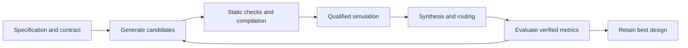

# AutoRTL

[](https://github.com/Baah134/autortl/actions/workflows/tests.yml)

**An agentic FPGA design loop where the model only proposes and verification decides.**

AutoRTL writes and optimizes Verilog with LLM agents, driving AMD Vivado
from the command line. Every candidate must pass static checks, simulation
against a testbench that has itself been shown to catch injected bugs, and
place-and-route timing before it can replace the current design. The model
reads the specification but cannot change it, the testbench, the TCL or the
acceptance gates.

## Highlights

- **Verified optimization.** A generated signed FIR filter went from failing
  timing at 78 LUTs to 52 LUTs with +0.169 ns setup slack. The saved winner
  then passed the independent 800-cycle testbench admitted with the
  specification.
- **Verifiers that are tested themselves.** An audit injected 27 behavioral
  faults into the FIR. The generated testbenches caught only 18. Better
  stimulus raised that to 22 with no extra model calls, and the independent
  checker catches all 27.
- **Every winner runs on real hardware.** All six designs the harness
  produced run unedited on a Digilent Basys 3: the FIR, both dot products,
  the divider and both FIFOs. Each passed 50,000 transactions against an
  independent model with 0 mismatches, under randomized backpressure, and a
  deliberately wrong model was rejected every time. The board builds reproduce
  the harness's own resource measurements.
- **Engineering discipline.** A 1,450-test regression suite, crash-safe
  resumable runs, fixed model-call and tool-time budgets, and an error
  taxonomy keyed to Vivado message IDs.

## How it works



- **Fixed contracts.** Interfaces, reset behavior and cycle latency come from
  a typed specification. A candidate that changes them fails; it is never
  renegotiated.
- **Qualified verification.** Before a testbench grades anything, it must pass
  a correct control and fail a deliberately broken design. Generated stimulus
  covers specification examples, signed extremes, idle cycles and reset.
- **Measured selection.** Timing feasibility comes before resource savings.
  Candidates are deduplicated by exact source, and every score comes from
  routed Vivado reports.
- **Safe failure handling.** Tool crashes, locks and timeouts never alter the
  design or count as a failed attempt. Message severities can be raised,
  never lowered.
- **Traceable evidence.** Every result is archived with source hashes,
  constraints, tool version and raw reports. On every push, CI checks every
  SHA-256 claim in the evidence manifests and source freezes (over 23,000)
  against the committed bytes
  ([audit](evidence/2026-10-28/evidence-integrity-01/README.md)).

## What the agent actually changed

In the FIR run, the baseline core passed the backpressure signal through a
three-stage combinational chain and multiplied by constants:

```verilog
wire ready3 = !valid3 || out_ready;
wire ready2 = !valid2 || ready3;
wire ready1 = !valid1 || ready2;
assign in_ready = ready1;
...
(x_wide * 16'sd3) - (history1_wide * 16'sd5) + (history2_wide * 16'sd7) - (history3_wide * 16'sd2)
```

The verified winner tracks pipeline occupancy in a register instead, which
cuts the input-ready path to a single gate, and it uses shift-and-add terms:

```verilog
assign in_ready = !full || out_ready;
...
full <= next_valid1 && next_valid2 && next_valid3;   // inside the clocked block
...
wire signed [15:0] x_times3        = (x_wide <<< 1) + x_wide;
wire signed [15:0] history1_times5 = (history1_wide <<< 2) + history1_wide;
wire signed [15:0] history2_times7 = (history2_wide <<< 3) - history2_wide;
```

Full sources: [baseline core](evidence/2026-10-26/generated-signed-fir4-attempt-01/run/modules/signed_fir4_core/signed_fir4_core.v)
and [winner](evidence/2026-10-26/generated-signed-fir4-attempt-01/run/signed_fir4_best.v).

## Verified results

| Design | Recorded result |
|---|---|
| Signed stateful FIR filter | **78 → 52 LUTs · setup −0.327 → +0.169 ns · hold +0.106 ns · independent 800-cycle test passed** |
| Elastic dot product | **328 → 20 LUTs · 4 DSPs · setup +0.155 ns / hold +0.206 ns · independent 852-cycle test passed** |
| Three-module pipelined dot product | **325 → 17 LUTs · 4 DSPs · independent 685-cycle test passed** |
| Iterative divider (8-bit) | **38 → 26 LUTs · setup +0.315 ns / hold +0.129 ns · saved winner independently passed** |
| FIFO timing recovery | **Setup −0.931 → +0.108 ns · hold +0.076 ns · 22 LUTs / 13 FFs** |
| Packet-tagged FIFO | **23 LUTs / 31 FFs · setup +0.078 ns / hold +0.106 ns · saved winner independently passed** |
| Fault-qualified independent verification | **27 signed FIR faults, 18 elastic arithmetic faults and 20 divider faults detected; correct controls passed** |
| Harness regression | **1,450 tests passed** |

These use Vivado 2025.2 on `xc7a35tcpg236-1` (the Basys 3's FPGA) at
100 MHz with ideal zero I/O delays. The dot-product savings trade fabric
logic for DSP slices, and FIFO timing recovery uses more area than its
failing baseline. Estimated power rose slightly for the dot products and the
divider. A second, separate FIR run reached timing at 84 LUTs, so results
vary between runs. Details: [hardware targets](docs/TARGETS.md).

Evidence: [signed FIR](evidence/2026-10-26/generated-signed-fir4-attempt-01/README.md),
[FIR fault qualification](evidence/2026-10-25/signed-fir4-admission-attempt-01/README.md),
[second FIR run](evidence/2026-10-26/generated-signed-fir4-attempt-02/README.md),
[generated-verifier audit](evidence/2026-10-26/fir4-driver-comparison-01/README.md),
[elastic dot product](evidence/2026-10-25/generated-elastic-dot4-attempt-02/README.md),
[three-module dot product](evidence/2026-10-24/generated-dot4-attempt-01/README.md),
[divider](evidence/2026-10-23/generated-divider-attempt-01/README.md),
[FIFO](evidence/2026-10-22/generated-fifo-attempt-05/README.md),
[packet FIFO](evidence/2026-10-22/generated-packet-attempt-01/README.md),
[full regression](evidence/2026-10-26/fir4-coverage-tests-01/README.md).

## Hardware validation on a Basys 3

[`hardware/basys3/harness_winners`](hardware/basys3/harness_winners/README.md)
runs every harness winner on the board through one generic, tested shell:

| Design | On board vs model | Winner LUT / FF / DSP on board | Harness-measured |
|---|---|---:|---:|
| Signed FIR | 50,000/50,000 | 51 / 67 / 0 | 52 / 67 / 0 |
| Elastic dot product | 50,000/50,000 | 20 / 20 / 4 | 20 / 20 / 4 |
| Pipelined dot product | 50,000/50,000 | 17 / 18 / 4 | 17 / 18 / 4 |
| Iterative divider | 50,000/50,000 | 26 / 30 / 0 | 26 / 38 / 0 |
| Packet FIFO | 50,000/50,000 | 22 / 29 / 0 | 23 / 31 / 0 |
| Sync FIFO | 50,000/50,000 | 21 / 13 / 0 | 22 / 13 / 0 |

- **Independent models.** Each is checked against a Python model written from
  the frozen specification, not from the harness's own oracle.
- **Real backpressure.** An LFSR traffic shaper creates the valid/ready stress
  that UART traffic alone never would. Coverage counters prove it happened,
  and each design's injected fault must make its simulation fail.
- **Explained differences.** The divider's 8-FF difference turned out to be
  `opt_design` replicas that exist only when it is built standalone
  ([analysis](evidence/2026-10-28/divider-ff-replica-analysis-01/README.md)).
- **Traceable.** The board's bitstream payloads are tied by hash to the hardware
  runs ([evidence](evidence/2026-10-28/basys3-harness-winners-01/README.md)).
  The tested bitstreams are archived, so a board and a fresh clone can rerun
  every check without synthesis
  ([bitstreams](evidence/2026-10-28/basys3-bitstreams-01/README.md)). A
  replay from those files reproduced all six results exactly
  ([replay](evidence/2026-10-28/basys3-bitstream-replay-01/README.md)).

The FIR was first run on its own, with its own shell:
[`hardware/basys3/fir4_on_board`](hardware/basys3/fir4_on_board/README.md)
runs the harness's FIR winner, byte-identical to the verified file, behind a
hand-written UART shell. The PC streams signed samples, starting with the
worst-case extremes, and checks every output against a Python model of the
filter. A UART break restarts the filter between runs.

- 100,000 samples matched with 0 mismatches across 4 restarts.
- A model with one wrong coefficient failed on 4,965 of 5,000 outputs.
- In simulation, a faulted copy of the FIR fails the testbench, whether the
  fault is a wrong coefficient or a missing reset.
- Build: 0 warnings, setup +2.718 ns at 100 MHz
  ([evidence](evidence/2026-10-28/basys3-fir4-01/README.md)).

The board path itself was proven first with a hand-written UART echo,
[`hardware/basys3/uart_echo`](hardware/basys3/uart_echo/README.md): real pin
constraints, bitstream, programming, and a PC-side checker that compares every
byte.

The first version passed chunked tests. An independent review then predicted
it would drop bytes under continuous traffic, because its transmitter was
fractionally slower than the PC. A line-rate test confirmed this on the
board: the first byte was lost after 9,696. The fix shortens the transmitted
stop bit by 1/16 bit and handles line breaks. Each fix has a simulation that
fails when it is reverted, and the fixed design streamed 1,000,000 bytes with
zero loss ([evidence](evidence/2026-10-28/basys3-uart-echo-02/README.md)).

Next: let the harness build designs for the board directly, with real pin
constraints and this hardware check as an acceptance gate.

## What went wrong, and what changed

- **The generated verifiers missed bugs.** Generated testbenches passed 9 of
  27 injected faults. The fix added signed boundary values, legal idle
  traffic and off-edge reset pulses without changing the oracle or budgets,
  and detection rose to 22/27. The remaining 5 involve reset behavior that
  the generic specification cannot express, so independent contract checks
  still cover them.
- **A passing test is not proof.** The UART's first test paused between
  chunks and could never fail the way the design actually failed. Every new
  check here now ships with a fault that it must catch.
- **Run-to-run variance is real.** Two FIR runs with the same specification
  and budget ended at 52 and 84 LUTs, so single runs are reported as single
  runs.
- **The archives had holes.** A repository-wide audit found 817 of 23,194
  recorded claims that the committed files did not back up. Most were
  simulator files that a manifest listed but that were never copied into the
  archive. The exact bytes were restored from the original run folders where
  they survived. The rest are proven another way or recorded as losses, each
  one pinned to its digest. CI now fails if any claim stops matching
  ([audit](evidence/2026-10-28/evidence-integrity-01/README.md)).

## Limits

These are bounded experiments on small designs. They are not formal
equivalence proofs or board-level timing sign-off, and they do not show that
the harness beats a skilled engineer or Vivado's own optimizations. No
curriculum tier is held yet: that needs three consecutive qualifying full
runs. Each run uses Codex CLI for its model calls.

## Quick start

Requirements: Python 3.12, Vivado with the target device installed, and an
authenticated Codex CLI for model-driven runs. Runtime roles use the
configured Codex model through [`llm/routing.yaml`](llm/routing.yaml).

```powershell
python -m pip install -r requirements.txt
```

Set the Vivado installation path. The following examples use PowerShell:

```powershell
$vivadoBin = "C:/path/to/Vivado/bin"
$vivadoArgs = @(
  "--vivado", "$vivadoBin/vivado.bat",
  "--xvlog", "$vivadoBin/xvlog.bat",
  "--xelab", "$vivadoBin/xelab.bat",
  "--xsim", "$vivadoBin/xsim.bat"
)
```

First, run the repeatable counter tool check without model calls:

```powershell
python scripts/check_counter_cli.py --bin-dir $vivadoBin --output runs/counter-check
```

Optimize an existing design with a testbench and bounded resources:

```powershell
python run.py optimize --design curriculum/tier0/mux4/mux4.v `
  --tb curriculum/tier0/mux4/mux4_tb.v --top mux4 `
  --iterations 1 --best-of-n 1 --max-llm-calls 16 `
  --max-vivado-minutes 20 --max-wall-minutes 30 `
  --output-dir runs/mux-trial @vivadoArgs
```

`build` accepts a typed JSON specification or a prose request. The repository
includes [signed FIR](curriculum/tier3/signed_fir4_build/),
[counter8](curriculum/tier1/counter8_build/) and
[priority encoder](curriculum/tier1/encoder8_build/) specifications with
independent top-level testbenches. Supply these using `--spec`, `--tb` and `--top`.
Add `--generate-golden` to combine generated Python/unit verification with the
independent testbench, including child repair and optimization gates. See the
[golden verification guide](docs/GOLDEN_VERIFICATION.md) for semantics and limits.

Resume an interrupted experiment using its saved configuration:

```powershell
python run.py resume --run runs/mux-trial
```

Use a fresh output directory for each new experiment. Resume checks the saved
inputs and execution environment; see [recovery behavior](docs/RECOVERY.md).

## Development and evaluation

Continuous integration
([`.github/workflows/tests.yml`](.github/workflows/tests.yml)) runs the full
harness suite on Windows. It also runs the mailbox and board-suite tests on
Windows and Ubuntu. None of these need Vivado, a model login or a board.

```powershell
python -m pytest tests/ -q
python -m pytest coordination hardware/basys3/harness_winners/tests -q
python run.py bench --tier 0 --iterations 1 --best-of-n 1 `
  --max-llm-calls 16 --max-vivado-minutes 20 --max-wall-minutes 30 `
  --output-dir runs/tier0 @vivadoArgs
```

Curriculum promotion requires three consecutive qualifying full runs with the
same experiment cohort. Subset runs cannot promote a tier, and regressions in
previously passing entries of a held cohort block qualification.

Start with the [guided code tour](docs/WALKTHROUGH.md), which follows one run
through the code with file and line references. Then read the
[architecture](docs/DESIGN.md), [recovery and validation guide](docs/RECOVERY.md),
[research and adoption decisions](docs/RESEARCH.md),
and [engineering evidence log](docs/PROGRESS.md) for implementation details,
tested guarantees and remaining work.
